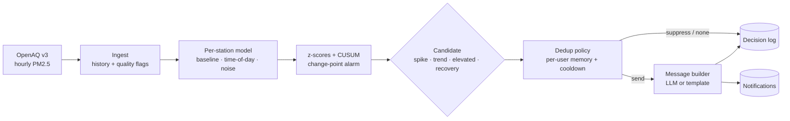

Proactive Air Quality Insight Agent
A backend that watches hourly air quality data and speaks up only when something is actually worth knowing.


Demo video · Quick start · How it works · Results · Design note
</div>
---
Why this exists
Users don't want to open an app and check a number every hour. They want to be told, unprompted, when air quality changes in a way that matters, and not to be told the same thing six times. This service ingests hourly OpenAQ PM2.5 for five cities and decides when to notify, what to say, and what not to repeat. Every decision, including every decision to stay silent, is recorded and explainable.
Demo
> 🎥 **Video walkthrough:** _add your Loom link here_
One long bad stretch becomes one message	A one-hour sensor glitch is rejected
	
Highlights
Learned, per-station detection. Each station fits its own baseline, time-of-day pattern and noise level, then a CUSUM change-point alarm flags spikes, trends, sustained elevation and recovery. No single global threshold.
Dedup with memory. Six bad hours produce one message. It speaks again only on a worse AQI band, a major worsening, or recovery, with a cooldown that backs off and decays.
Messages, not status lines. Short notifications that reference past context and end with one next action tailored to the user.
Debuggable by design. Every evaluation is logged with its inputs, every check's result, and the user's state before and after.
Replayable. An evaluation harness runs history through the same pipeline and reports caught versus missed events.
How it works

<details>
<summary><b>Detection rules</b></summary>
Candidate	Fires when all of these hold
spike	z ≥ 3.25 now, the previous hour is also elevated (kills one-hour glitches), ≥ 1.5× the median of recent hours, ≥ 12 AQI above expected
trend	CUSUM alarm, z ≥ 2.0 with the previous hour confirming, at least 3 of 4 hourly steps up, positive Theil-Sen slope, rise ≥ 25% and ≥ 12 points over 5 hours
elevated	CUSUM alarm and z ≥ 2.5 for two consecutive hours (a shift that is no longer rising)
recovery	Only inside an alerted episode: z ≤ 1.0 for 3 hours and AQI ≤ 75% of the episode peak
A per-user `sensitivity` divides the thresholds, so a higher value lowers the bar. Invalid readings and runs of 6+ identical values (stuck sensors) are flagged and excluded, and a stale feed is logged as `stale_data`.

</details>
<details>
<summary><b>Dedup and cooldown rules</b></summary>
New worsening candidate while quiet: send, unless still in cooldown from a recent alert and not worse.
Inside an episode: speak again only for a band escalation (at least 1 hour apart) or a major worsening (≥ 35% and ≥ 30 points, only after the cooldown).
Recovery is sent once, and only if an alert was sent in that episode.
Cooldown backs off 3h → 6h → 12h → 24h per alert in a streak and decays by one step per 12 hours of silence.
</details>
<details>
<summary><b>Example messages</b></summary>

An LLM writes the text if `ANTHROPIC_API_KEY` is set. Otherwise a deterministic template is used, and it is also the fallback if the LLM call fails or returns something invalid.
</details>
Quick start
Requires Python 3.10+.
```bash
git clone https://github.com/Hydrapradeep/proactive-air-quality-agent.git
cd proactive-air-quality-agent
pip install -r requirements.txt
python -m pytest -q
```
Offline demo (no network, no keys)
```bash
python -m aqi_agent demo     # replays 28 simulated days, writes demo.db and reports in docs/
```
Then start the dashboard on that data.
```bash
# macOS / Linux
AQI_DB=demo.db AQI_SCHEDULER=off AQI_SOURCE=none python -m aqi_agent serve
```
```powershell
# Windows PowerShell
$env:AQI_DB="demo.db"; $env:AQI_SCHEDULER="off"; $env:AQI_SOURCE="none"; python -m aqi_agent serve
```
Open http://127.0.0.1:8000.
Live against OpenAQ
Get a free key at https://explore.openaq.org/register.
```bash
export OPENAQ_API_KEY=...          # PowerShell: $env:OPENAQ_API_KEY="..."
export ANTHROPIC_API_KEY=...       # optional, for LLM-written messages
python -m aqi_agent check-openaq   # resolves a PM2.5 sensor per city, prints recent rows
python -m aqi_agent serve          # hourly job at HH:05, backfills 7 days at startup
```
<details>
<summary><b>All commands and settings</b></summary>
Command	What it does
`python -m aqi_agent serve`	API, dashboard and hourly scheduler
`python -m aqi_agent tick`	One ingest and evaluate pass
`python -m aqi_agent demo`	Simulated 28-day replay with reports
`python -m aqi_agent eval --source sim|db`	Evaluation on simulated or stored real history
`python -m aqi_agent check-openaq`	Verify the OpenAQ client with your key
`python -m scripts.demo_walkthrough`	Narrated terminal walkthrough for recording
`python -m scripts.make_video`	Captioned demo video (needs Pillow and ffmpeg)

Environment variable	Default	Purpose
`AQI_DB`	`aqi_agent.db`	SQLite path
`AQI_SOURCE`	`openaq`	`openaq`, or `none` for dashboard-only
`OPENAQ_API_KEY`	none	OpenAQ v3 key
`ANTHROPIC_API_KEY`	none	Enables LLM-written messages
`AQI_LLM_MODEL`	`claude-haiku-5-5`	Model for message wording
`AQI_SCHEDULER`	`on`	`off` disables the hourly job
`AQI_MINUTE`	`5`	Minute of the hour for the job
Cities and demo users are defined in `aqi_agent/config.py`.
</details>
Observability
Endpoint	What it shows
`/`	Dashboard: chart per city with alert markers, notifications, recent decisions, per-user memory
`/api/decisions`	One row per evaluation. Filters: `station_id`, `user_id`, `action`, `candidate_only`
`/api/decisions/{id}`	Full trace: fitted model, thresholds, every check with its numbers, 24h window with z-scores, policy state before and after, the notification and its context
`/api/notifications`	Notification history
`/api/state`	Dedup memory per user
`/api/readings/{station}`, `/api/ingest_runs`, `/api/stations`, `POST /api/tick`	Data and ingestion health
Debugging a missing nudge: open the decision for that hour. `reason` says why (`no_candidate`, `stale_data`, `insufficient_history`, `duplicate_ongoing_episode`, `flap_cooldown_recent_alert`, `worsening_but_in_cooldown`) and `checks` shows which detector condition failed.
Results
Simulated replay: 28 days × 5 cities with injected spikes, trends, sensor glitches, stuck sensors and missing hours (ground truth known).
Metric	Result
Spikes caught	9 / 10
Trends caught	6 / 6
Recoveries caught	10 / 15
Precision	0.59
Alerts per city-day	0.49 (a naive "AQI > 100 every hour" alerter sends 5.88)
Median detection delay	1 hour
Injected glitches and stuck sensors produced no alerts. Details: docs/EVAL_REPORT.md.
Project structure
```
aqi_agent/
├── detector.py     learned model, CUSUM, spike/trend/elevated/recovery checks
├── policy.py       dedup and cooldown state machine
├── engine.py       history → model → candidate → policy → message → decision log
├── messages.py     context building, action selection, LLM and template messages
├── ingest.py       storage, quality flags, ingestion loop
├── openaq.py       OpenAQ v3 client
├── simulator.py    ground-truth simulator
├── evaluate.py     replay and scoring harness
└── app.py          FastAPI service, scheduler, dashboard
tests/              AQI conversion, glitch rejection, dedup, stuck sensor, OpenAQ client (mocked)
scripts/            demo, narrated walkthrough, video generator
docs/               design note, evaluation, notification history, AI usage
```
Limitations
The OpenAQ client has only been tested against a mocked response. The environment this was built in could not reach OpenAQ, so the client follows the documented v3 response shapes but has not run against the live API. Run `python -m aqi_agent check-openaq` first. Everything after ingestion is source-independent.
The evaluation uses simulated data, and the detector thresholds were tuned on it. Treat the numbers as a regression check, not proof of real-world accuracy. Once you have real history, `python -m aqi_agent eval --source db` replays it with simple model-free labels.
Ordinary noise swings in the simulated series are scored as false positives even though a user might want to hear about them.
SQLite and an in-process scheduler suit a handful of stations. For scale, use Postgres and a job queue.
Documentation
Design and architecture note
Evaluation report
Notification history
AI tools used
License
MIT, see LICENSE.
